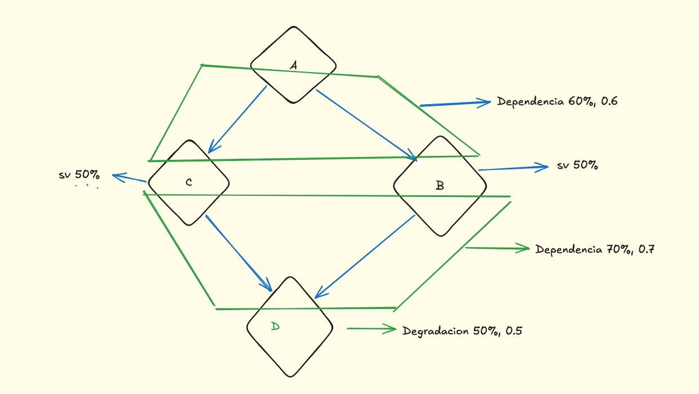
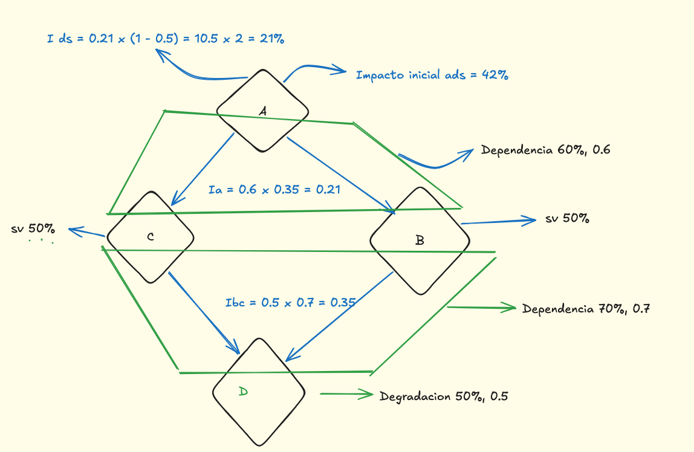
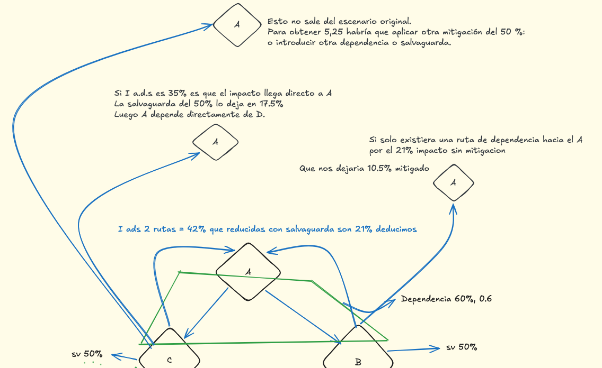

<div align="center">

# INFORME TÉCNICO

## AP13 · Propagación del impacto por dependencias

### Fortune Bank

<br>

**Auditor:** Xavier Margalef Riestra

**Metodología:** [MAGERIT v3](https://administracionelectronica.gob.es/pae_Home/pae_Documentacion/pae_Metodologias/pae_Magerit.html) · [Esquema Nacional de Seguridad (ENS)](https://www.ccn-cert.cni.es/es/seguridad-al-dia/esquema-nacional-de-seguridad)

**Actividad:** Dependencias entre activos y propagación del impacto

**Fecha:** Julio 2026

<br>


</div>

<div style="page-break-after: always;"></div>

# Introducción

Este informe analiza la propagación del impacto entre activos bajo el modelo de la metodología **MAGERIT v3**. El objetivo es determinar cómo una degradación operativa en un activo de soporte escala verticalmente afectando a los componentes superiores, calculando el impacto final transferido al servicio de negocio.

Asimismo, se evalúa la eficacia de implementar **salvaguardas** para obtener el impacto residual y se determina el patrón estructural de dependencias de la arquitectura analizada.

---

# Planteamiento

Evaluación del comportamiento del sistema de transferencias de **Fortune Bank** ante una caída por fallo de hardware.

La infraestructura consta de los siguientes componentes:

- **Activo A:** Sistema Core de transferencias.
- **Nodo B:** Middleware de procesamiento.
- **Nodo C:** Middleware de procesamiento.
- **Servidor D:** Servidor hardware base del que dependen ambos middlewares.

**Métricas del escenario:**

- El **Servidor D** sufre una degradación inicial del **50 %** por fallo físico.
- Los nodos **B** y **C** tienen un grado de dependencia del **70 %** respecto al Servidor D.
- El **Sistema Core (A)** depende en un **60 %** de cada uno de los middlewares, de forma independiente.
- Las salvaguardas aplicadas presentan una eficacia frente al impacto del **50 %**.

<div style="page-break-after: always;"></div>

# Identificación de activos

Aplicando los criterios de **MAGERIT v3**, se clasifican los activos diferenciando los elementos esenciales de negocio de los activos de soporte de infraestructura.

| Activo | Tipo | Función |
|---|---|---|
| **Activo A** | Activo esencial | Sistema Core de transferencias. Servicio crítico de negocio. |
| **Nodo B** | Activo de soporte | [Middleware](https://owasp.org/www-community/Application_Architecture) de procesamiento transaccional. |
| **Nodo C** | Activo de soporte | Middleware homólogo al Nodo B. |
| **Servidor D** | Soporte crítico | Servidor hardware compartido. Constituye un **[Single Point of Failure (SPOF)](https://en.wikipedia.org/wiki/Single_point_of_failure)**. |

Dado que el valor del negocio reside en el activo esencial, este se transmite de forma descendente hacia los activos de soporte mediante las relaciones de dependencia. En consecuencia, un incidente en el componente base **Servidor D** repercute de forma ascendente directa sobre la disponibilidad operativa del **Sistema Core**.

<div align="center">



</div>

---

# Topología de dependencias

El flujo jerárquico de dependencias se estructura de la siguiente manera:

```text
          Activo A
         /        \
      60 %      60 %
      /            \
 Nodo B          Nodo C
      \            /
      70 %      70 %
         \      /
        Servidor D
```

La arquitectura define una **dependencia convergente** (topología en diamante). El **Servidor D** actúa como un **SPOF**: un impacto en este componente compromete simultáneamente ambos canales intermedios, al carecer el diseño actual de mecanismos de tolerancia a fallos o balanceo de carga.

<div style="page-break-after: always;"></div>

# 1. Impacto inicial sobre el Sistema Core (Activo A)

Ante una degradación del 50 % en el Servidor D, el cálculo del impacto repercutido se basa en la fórmula formal de la metodología:

> **Impacto Repercutido = Degradación · Grado de Dependencia**

### Paso 1: Del Servidor D a los nodos intermedios de soporte

- **Nodo B:** `0,50 · 0,70 = 0,35` → **35 % de impacto**
- **Nodo C:** `0,50 · 0,70 = 0,35` → **35 % de impacto**

### Paso 2: De los nodos intermedios al Activo Esencial (A)

Cada canal de procesamiento traslada el impacto acumulado hacia el Activo A aplicando su grado de dependencia correspondiente del **60 %** (0,60):

- **Ruta B → A:** `0,35 · 0,60 = 0,21` → **21 % de impacto**
- **Ruta C → A:** `0,35 · 0,60 = 0,21` → **21 % de impacto**

### Cálculo del impacto total acumulado

Al coexistir dos rutas de transmisión convergentes simultáneas, sin redundancia activa en esta fase, se agrega el impacto recibido por ambas vías sobre el activo de negocio:

> `21 % + 21 % = 42 %`

**Impacto inicial total en el Sistema Core (Activo A): 42 %.**

# 2. Impacto residual tras implantar salvaguardas

Se introducen medidas orientadas a acotar la degradación (caché local en los Nodos B y C) con una eficacia frente al impacto (eᵢ) del **50 %** (0,50). Aplicando la ecuación de impacto residual:

> **Impacto Residual = Impacto Inicial · (1 − eᵢ)**

- **Ruta B mitigada:** `21 % · (1 − 0,50) = 10,5 %`
- **Ruta C mitigada:** `21 % · (1 − 0,50) = 10,5 %`

**Impacto residual final consolidado en el Core:** `10,5 % + 10,5 % = 21 %`

<div style="page-break-after: always;"></div>

# 3. Patrón de dependencias y resumen

<div align="center">



</div>

La expresión formal que define la topología estructural en diamante corresponde a:

> `(A → B) ∧ (A → C) ∧ (B → D) ∧ (C → D)`

| Concepto técnico | Valor operativo |
|---|---|
| Degradación inicial del Servidor D (d) | **50 %** |
| Grado de dependencia Nodos (B/C) → Servidor D | **70 %** (0,70) |
| Impacto intermedio en Nodos B y C | **35 %** |
| Grado de dependencia Activo A → Nodos (B/C) | **60 %** (0,60) |
| **Impacto inicial total en Activo A** | **42 %** |
| **Impacto residual total en Activo A** | **21 %** |
| Patrón estructural de la arquitectura | **Dependencia en diamante** |
| Componente crítico detectado | **Servidor D (SPOF)** |

---

# Escenarios alternativos (ingeniería inversa)

Para evaluar escenarios alternativos se realiza un análisis de ingeniería inversa: partiendo del impacto final reflejado en el activo raíz (i_A), se despeja secuencialmente hacia atrás para identificar la degradación requerida en el activo base de infraestructura.

Expresiones usadas para el despeje directo:

1. **Impacto intermedio en el nivel de middleware:** `Impacto_Nodo = Impacto_Ruta / grado(A → Nodo)`
2. **Degradación requerida en el componente hardware raíz (Servidor D):** `Degradación_D = Impacto_Nodo / grado(Nodo → D)`

*Constantes fijas del sistema:* grado(A → B/C) = 0,60 · grado(B/C → D) = 0,70 · eficacia de salvaguarda (eᵢ) = 50 %.

| Escenario | i_A | Cálculo (top-down) | Nodos | d_D | Residuo |
|---|---|---|---|---|---|
| **1. Diamante** | 42 % | Por rama: Impacto_Ruta = 21 %. En nodo: 0,21/0,60 = 0,35. En raíz: 0,35/0,70 = 0,50. | d_B = 35 % · d_C = 35 % | **50 %** | **21 %** |
| **2. Ruta única** | 21 % | Un solo canal activo transmite: Impacto_Ruta = 21 %. En nodo: 0,21/0,60 = 0,35. En raíz: 0,35/0,70 = 0,50. | d_B = 35 % · d_C = 0 % | **50 %** | **10,5 %** |
| **3. Conexión directa** | 35 % | Arquitectura plana. A acopla directo a D (grado = 0,70). En raíz: 0,35/0,70 = 0,50. | d_B = N/A · d_C = N/A | **50 %** | **17,5 %** |
| **4. Doble salvaguarda** | 21 % | Flujo idéntico al Escenario 2. Impacto_B = 35 % → Degradación_D = 50 %. Controles en serie: 21 % · (1−0,50) · (1−0,50). | d_B = 35 % · d_C = 0 % | **50 %** | **5,25 %** |

<div align="center">



</div>

---

# Conclusiones y recomendación

El hallazgo central no es un fallo de software ni una vulnerabilidad de código, sino un **defecto de diseño de arquitectura**: el Servidor D concentra el 100 % del riesgo de disponibilidad de los dos únicos canales de procesamiento del Sistema Core, sin redundancia activa ni balanceo de carga. Eso convierte un fallo de hardware físico —no un ataque— en el escenario de mayor impacto potencial sobre el servicio de negocio (42 % de impacto repercutido sin mitigar).

La comparación de escenarios muestra que el margen de mejora no está solo en "añadir una salvaguarda", sino en **cambiar el patrón de dependencia**: pasar de una topología en diamante (ambos nodos dependientes del mismo servidor) a rutas verdaderamente independientes reduciría el impacto máximo posible, incluso antes de aplicar ninguna salvaguarda adicional. Las salvaguardas en serie (Escenario 4) son la opción de menor impacto residual (5,25 %), pero solo si cada control es independiente del anterior — dos cachés que dependan del mismo servidor físico no reducirían el riesgo real, solo lo ocultarían en el cálculo.

**Recomendación priorizada:** eliminar el Servidor D como punto único de fallo (redundancia activa o migración a infraestructura con tolerancia a fallos) antes de invertir en salvaguardas adicionales sobre la arquitectura actual — atacar la causa raíz estructural, no solo mitigar sus síntomas.

---

# Referencias

### Metodologías y normativa oficial

- **MAGERIT v3** — Metodología de Análisis y Gestión de Riesgos de los Sistemas de Información. Ministerio de Asuntos Económicos y Transformación Digital.
- **Esquema Nacional de Seguridad (ENS)** — Real Decreto 311/2022. Centro Criptológico Nacional (CCN).
- **ISO/IEC 27001:2022** — Information Security Management Systems — Requirements.
- **DORA (Digital Operational Resilience Act)** — Reglamento (UE) 2022/2554, de aplicación directa al sector financiero europeo desde 2025: exige explícitamente mapeo de dependencias críticas y pruebas de resiliencia operativa como el análisis realizado en este informe.

### Marcos técnicos

- **Single Point of Failure (SPOF)** — OWASP Application Architecture Mitigation Standards.
- **Defense in Depth** — NIST Cybersecurity Framework (CSF 2.0).
