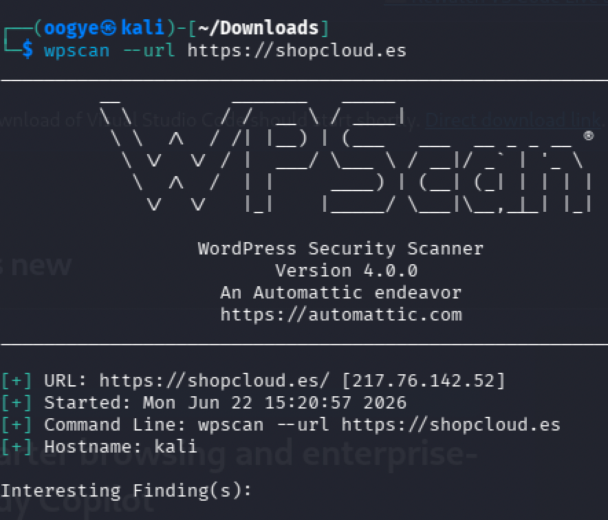
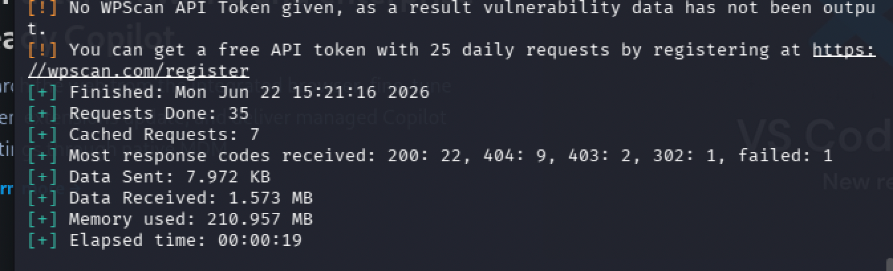
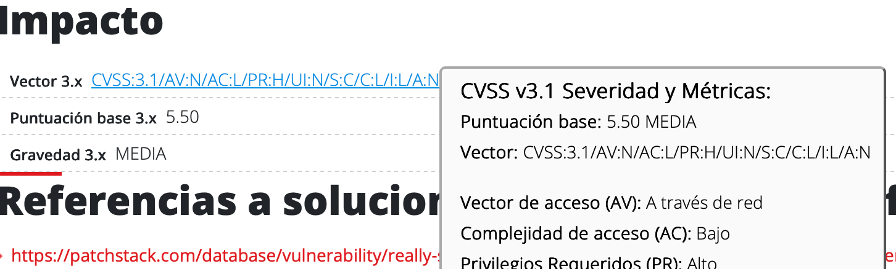
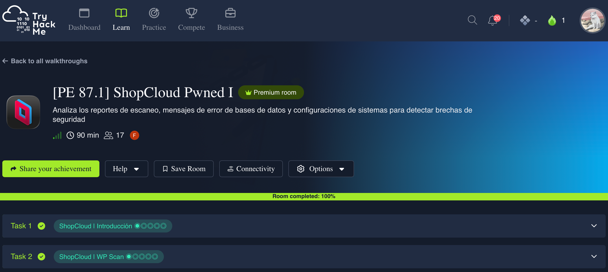
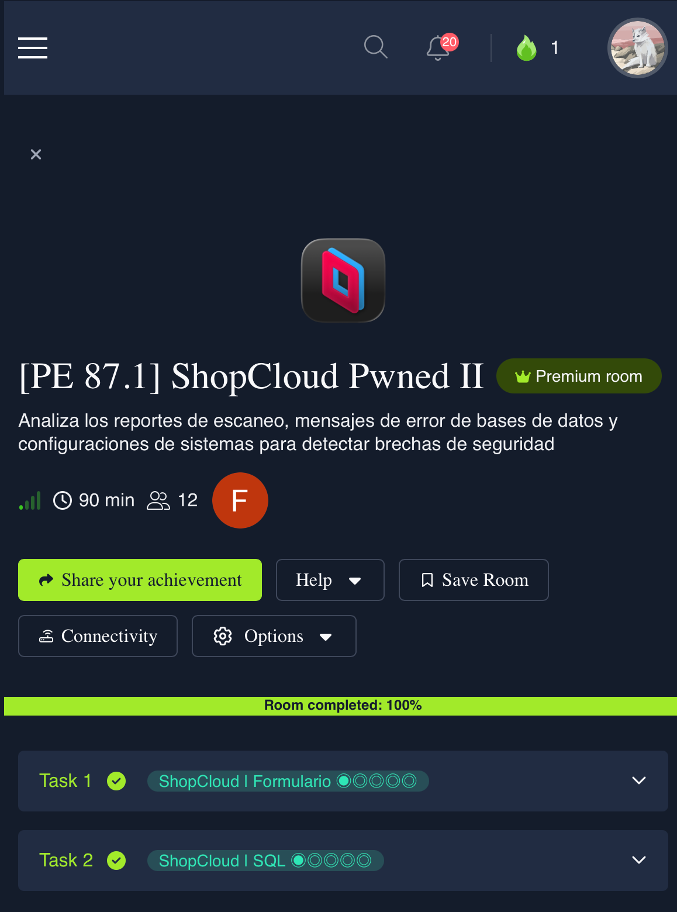
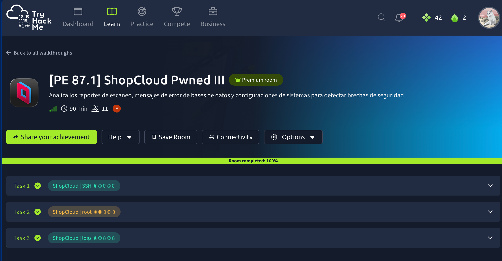

# Cuaderno de Auditoría: ShopCloud S.L.

**Auditor:** Xavier Margalef Riestra
**Cliente:** ShopCloud S.L.
**Rol:** Auditor Junior de Ciberseguridad
**Fecha:** Julio 2026
**Alcance:** Auditoría de vulnerabilidades perimetral e interna sobre la infraestructura WordPress/WooCommerce de ShopCloud

<br>

> Este documento recoge el proceso técnico y la evidencia bruta de la auditoría, fase por fase. La síntesis ejecutiva, la matriz de hallazgos priorizada y las fichas de remediación formales se entregan en el informe `pe-87-1-xavier-margalef.pdf`, dirigido al cliente.

---

## Resumen

La auditoría se ejecuta en dos fases: una fase de campo (reconocimiento, explotación y análisis post-explotación sobre la infraestructura de ShopCloud) y una fase de comunicación de resultados al cliente. Se encadenan cuatro hallazgos independientes hasta alcanzar el compromiso total del servidor: un plugin de WordPress con una RCE no autenticada conocida, una inyección SQL por falta de sanitización en el panel de clientes, credenciales en texto plano y hash débil (MD5) en la base de datos, y una escalada de privilegios local mediante un binario SUID mal configurado. Un análisis final de logs de SSH confirma la cronología completa del ataque.

---

## Fase 1 — Reconocimiento y explotación

### 1.1 Escaneo de plugins (WPScan)

Escaneo con `wpscan` contra `https://shopcloud.es` (tras reconocimiento pasivo en buscadores), usando un token de API para desbloquear el detalle completo de hallazgos:

```bash
sudo apt-get install ruby-full
gem install wpscan
wpscan --url https://shopcloud.es --api-token <token>
```

Plugins detectados:

```
[+] Yoast SEO           — Versión: 24.9
[+] Wordfence Security  — Versión: 8.0.5
[+] Contact Form 7      — Versión: 6.1.1
[+] WooCommerce         — Versión: 10.7.0
[+] Elementor           — Versión: 3.31
[+] WP Super Cache      — Versión: 3.0.0
[+] WP File Manager     — Versión: 6.8
[+] Smush               — Versión: 3.20.1
[+] Really Simple SSL   — Versión: 7.2.3
[+] Jetpack             — Versión: 15.7
```

Contrastando versiones contra bases de datos de vulnerabilidades (NVD, WPScan, Patchstack) se identifican 3 componentes vulnerables: **WP File Manager 6.8**, **Really Simple SSL 7.2.3** y, en menor medida, **Jetpack 15.7**. De los tres, WP File Manager 6.8 es el más crítico por su vulnerabilidad de ejecución remota de código (RCE).

**Really Simple SSL 7.2.3 — CVE-2024-31229 (SSRF, CVSS 5.5, Medio)**
- Requiere privilegios elevados (`PR:H`) y tiene impacto contenido, lo que la diferencia de la vulnerabilidad de WP File Manager (sin privilegios previos, impacto alto).
- Vector de ataque: red (`AV:N`). [NVD](https://nvd.nist.gov/vuln/detail/CVE-2024-31229) · [CWE-918 SSRF (MITRE)](https://cwe.mitre.org/data/definitions/918.html)
- Corregida en la versión 8.0.0. [Patchstack](https://patchstack.com/database/wordpress/plugin/really-simple-ssl/vulnerability/wordpress-really-simple-ssl-plugin-7-2-3-server-side-request-forgery-ssrf-vulnerability)
- Última actualización pública del plugin: 16/06/2026, versión 9.6.0. Requiere PHP ≥ 7.4 y WordPress ≥ 6.6.

**WP File Manager 6.8 — CVE-2020-25213 (RCE, CVSS 10.0, Crítico)**
- Tipo: *Unrestricted Upload of File with Dangerous Type* ([INCIBE-CERT](https://www.incibe.es/en/incibe-cert/early-warning/vulnerabilities/cve-2020-25213)). Afecta a las ramas 6.0–6.9 del plugin.
- Causa raíz: el conector `connector.minimal.php` de la librería elFinder queda expuesto públicamente sin autenticación, permitiendo la subida directa de archivos PHP ejecutables (webshells).
- Explotada activamente en agosto-septiembre de 2020; existe un exploit público en GitHub (usuario `mansoorr123`, script `wp-file-manager-exploit.sh`) que automatiza la subida de la webshell sin interacción previa.
- Nivel de impacto: 5.9 (redondeado a 6.0). Corregida en la versión 6.9 (parche publicado el 1 de septiembre de 2020).
- **Clasificación de auditoría: No Conformidad Mayor.** Permite a un atacante no autenticado evadir por completo el control de acceso perimetral, con RCE pública y explotable que expone la confidencialidad de la base de datos de clientes y la disponibilidad de la infraestructura de producción — evidencia, además, de ausencia de un proceso efectivo de gestión de parches.






### 1.2 Fuga de información e inyección SQL (panel de clientes)

Al introducir una comilla simple (`'`) en el campo "Usuario" del panel de clientes para comprobar la sanitización de entradas, la aplicación devuelve un error fatal con stack trace completo en lugar de un mensaje genérico:

```
Fatal error: Uncaught mysqli_sql_exception: You have an error in your SQL syntax; check
the manual that corresponds to your MariaDB server version for the right syntax to use near
'admin'' AND password = '***'' at line 1 in /var/www/html/clientes/login.php:42

Stack trace:
#0 /var/www/html/clientes/login.php(42): mysqli->query('SELECT id, username, email,
hash_md5 FROM db_shopcloud_prod.users WHERE username = 'admin''...')
#1 {main}
  thrown in /var/www/html/clientes/login.php on line 42
```

Este stack trace, por sí solo, ya constituye un hallazgo de **fuga de información**: revela la ruta absoluta del servidor (`/var/www/html/clientes/`), el motor de base de datos (**MariaDB**), el nombre de la base de datos (**db_shopcloud_prod**), la tabla objetivo (**users**) y la línea exacta del código vulnerable (línea 42 de `login.php`). En un entorno de producción, la directiva de PHP `display_errors` debería estar en `Off` precisamente para evitar esta exposición.

A partir de este mismo punto de inyección se confirma una vulnerabilidad de **inyección SQL** en el motor MariaDB por falta de sanitización de la entrada, que permite volcar (dump) la tabla `users` completa:

```
+----+-------------+--------------------+-----------------------------------+
| id | username    | email              | hash_md5                          |
+----+-------------+--------------------+-----------------------------------+
|  1 |  admin_juan |  juan@shopcloud.io | 21232f297a57a5a743894a0e4a801fc3  |
|  2 |  admin_sara |  sara@shopcloud.io | e10adc3949ba59abbe56e057f20f883e  |
|  3 |  admin_test |  test@shopcloud.io | super_admin_123!                  |
+----+-------------+--------------------+-----------------------------------+
```

**Hallazgos sobre la gestión de credenciales:**
- `admin_test` almacena su contraseña **en texto plano** (`super_admin_123!`) — CWE-256 (*Plaintext Storage of a Password*, MITRE), categoría OWASP Top 10 A02 (*Cryptographic Failures*) / A07 (*Authentication Failures*).
- El resto de cuentas usan **MD5** para el hash de contraseñas — CWE-328 (*Use of a Broken or Risky Cryptographic Algorithm*), un algoritmo obsoleto y trivialmente reversible.
- Los dos hashes MD5 se revierten por tabla de consulta precalculada (CAPEC-55, *Rainbow Table Password Cracking*) usando Hashcat (`hashcat -m 0 hash.txt rockyou.txt`): `admin_juan` → `admin`, `admin_sara` → `123456`.
- **Recomendación:** migrar a **Argon2id** (recomendación #1 de OWASP *Password Storage Cheat Sheet* y avalado por NIST SP 800-63B), con Bcrypt como alternativa si Argon2id no está disponible en el entorno.



### 1.3 Archivos residuales y secretos expuestos en el servidor

Con acceso de bajo privilegio al servidor, se revisa el directorio público en busca de archivos residuales:

```
auditor@shopcloud$ ls -la /var/www/html/

total 48
drwxr-xr-x  5 www-data www-data 4096 Apr 20 10:00 .
drwxr-xr-x  3 root     root     4096 Apr 15 09:15 ..
-rw-r--r--  1 www-data www-data  418 Apr 15 09:15 index.php
-rw-r--r--  1 www-data www-data 3199 Apr 15 09:15 wp-config-sample.php
-rwxrwxrwx  1 www-data www-data 3215 Apr 20 10:05 wp-config.php
drwxr-xr-x  4 www-data www-data 4096 Apr 15 09:15 wp-content
drwxr-xr-x 20 www-data www-data 4096 Apr 15 09:15 wp-includes
-rw-r--r--  1 www-data www-data  199 Apr 15 09:15 .htaccess
-rw-rw-rw-  1 root     root     1024 Apr 20 08:30 backup_db.sql
-rw-r--r--  1 www-data www-data  512 Apr 18 16:45 test_conn.php
```

Dos hallazgos inmediatos de permisos y archivos residuales:

- **`wp-config.php` con permisos `777`** (`rwxrwxrwx`): el archivo de configuración crítico de WordPress es modificable por cualquier usuario del sistema, cuando debería restringirse al propietario del servicio web.
- **`backup_db.sql` expuesto en el directorio público**, con permisos de lectura/escritura para todos: filtra el contenido completo del último backup de la base de datos de producción.

Revisando `test_conn.php` (análisis de código fuente / code review):

```php
<?php
// Script de prueba para la migración al nuevo ERP
// ATENCIÓN: NO SUBIR A PRODUCCIÓN - Ticket #4521
// TODO: Eliminar de este servidor antes del 15 de Mayo
// Creado por: j.gomez (Departamento de Sistemas)

$ambiente = "dev";
// Llave de la pasarela de pago (Stripe)
$api_key = "<STRIPE_API_KEY_REDACTED>";
$db_host = "10.0.5.50";

function probarConexion() {
    // Nota interna: En caso de que se caiga el balanceador, usar la cuenta de rescate
    // del servidor de base de datos
    // ssh root@10.0.5.50 -p 2222 (Password: <REDACTED>)
    echo "Conexión a la red interna establecida correctamente.";
}

probarConexion();
?>
```

Este script de prueba, nunca retirado del servidor a pesar de su propio comentario de advertencia, filtra una **clave de API de Stripe** y una **contraseña de acceso root por SSH** a un servidor de base de datos interno (`10.0.5.50:2222`) — un caso de negligencia operativa individual (atribuible al ticket #4521, departamento de Sistemas) con impacto directo sobre la pasarela de pagos y la infraestructura de base de datos.

### 1.4 Escalada de privilegios local (bit SUID)

Búsqueda de binarios con el bit SUID activo (`Set User ID`), que ejecutan con los privilegios de su propietario en lugar de los del usuario que los invoca:

```bash
auditor@shopcloud:~$ find / -perm -u=s -type f 2>/dev/null

/usr/lib/openssh/ssh-keysign
/usr/lib/dbus-1.0/dbus-daemon-launch-helper
/usr/bin/passwd
/usr/bin/chfn
/usr/bin/base64
/usr/bin/gpasswd
/usr/bin/su
/usr/bin/mount
/usr/bin/umount
```

De toda la lista, `/usr/bin/base64` es el binario anómalo: no debería tener el bit SUID activo. Al tenerlo, y siendo su propietario `root`, permite leer cualquier archivo del sistema — incluido `/etc/shadow` — simplemente decodificando su salida ([referencia en GTFOBins](https://gtfobins.org/gtfobins/base64/)):

```bash
/usr/bin/base64 /etc/shadow | base64 --decode
```

Esto constituye una **lectura arbitraria de archivos** (*Arbitrary File Read*), distinta de la ejecución de comandos (*Command Execution*) que otros binarios SUID de la misma lista (como `bash` o `sh`) habrían permitido ([HackTricks — Linux Privilege Escalation, SUID/SGID Executables](https://hacktricks.wiki/en/index.html)). La causa raíz es la configuración insegura del bit SUID (CWE-269, *Improper Privilege Management*), no un fallo del binario en sí.

**Remediación inmediata:**
```bash
chmod 0755 /usr/bin/base64
```



### 1.5 Análisis SOC: cronología del ataque confirmada por logs

El SOC de ShopCloud detecta tráfico de red anómalo saliendo del servidor en horas de madrugada, días después del compromiso inicial, y aísla el servidor para su análisis forense:

```
auditor@shopcloud:~$ cat /var/log/auth.log | grep "May 12"

May 12 03:14:01 shopcloud sshd[14522]: Failed password for invalid user ftpadmin from 10.10.55.201 port 45212 ssh2
May 12 03:14:05 shopcloud sshd[14524]: Failed password for root from 10.10.55.201 port 45216 ssh2
May 12 03:14:10 shopcloud sshd[14528]: Accepted publickey for www-data from 10.10.55.201 port 45220 ssh2: RSA SHA256:X9pZ...
May 12 03:14:15 shopcloud sshd[14528]: pam_unix(sshd:session): session opened for user www-data by (uid=0)
May 12 03:15:22 shopcloud sudo[14601]: www-data : TTY=pts/1 ; PWD=/var/www/html ; USER=root ; COMMAND=/usr/bin/python3 -c 'import pty; pty.spawn("/bin/bash")'
```

La cronología reconstruida a partir del log confirma el patrón de ataque de extremo a extremo:

| Hora | Evento |
|---|---|
| 03:14:01 | Intento fallido de autenticación contra el usuario `ftpadmin`, origen `10.10.55.201` |
| 03:14:05 | Intento fallido de autenticación contra `root`, mismo origen |
| 03:14:10 | Autenticación por clave pública **aceptada** para `www-data`, mismo origen |
| 03:14:15 | Apertura de sesión para `www-data` con UID 0 (root) a nivel de PAM |
| 03:15:22 | `sudo` invocado por `www-data` desde `/var/www/html`, obteniendo una pseudo-terminal interactiva como `root` (PID 14601) |

El atacante, tras los intentos fallidos contra cuentas de mayor privilegio, consigue autenticarse como `www-data` (el mismo usuario comprometido en la fase de explotación de WP File Manager) desde la IP `10.10.55.201`, y en menos de 90 segundos obtiene una shell interactiva con privilegios de root — consistente con la cadena de hallazgos de este informe: RCE inicial → inyección SQL / fuga de credenciales → escalada de privilegios local vía SUID.

---

## Fase 2 — Comunicación de resultados

La síntesis ejecutiva de estos hallazgos (postura de riesgo, impacto de negocio, matriz de cumplimiento normativo frente a RGPD/ENS/ISO 27001, matriz de hallazgos priorizada con CVSS y fichas de remediación por vulnerabilidad) se entrega al cliente en el informe formal **`pe-87-1-xavier-margalef.pdf`**, estructurado por audiencia (dirección ejecutiva, legal/compliance, dirección técnica, administradores de sistemas).

**Matriz de hallazgos (resumen):**

| ID | Hallazgo | Riesgo | Estado |
|---|---|---|---|
| AUD-001 | RCE no autenticada en WP File Manager 6.8 (CVE-2020-25213) | **Crítico** | Abierto |
| AUD-002 | Inyección SQL + fuga de información en `login.php` | **Crítico** | Abierto |
| AUD-003 | Escalada de privilegios local vía bit SUID en `/usr/bin/base64` | **Alto** | Abierto |
| AUD-004 | Credenciales en texto plano / hash MD5 en `users` | **Alto** | Abierto |
| AUD-005 | Secretos expuestos en `test_conn.php` (API key de Stripe, contraseña root SSH) | **Alto** | Abierto |
