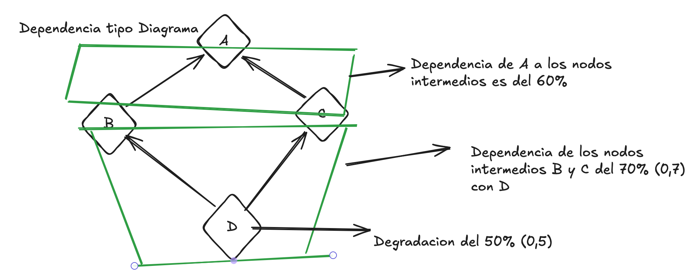
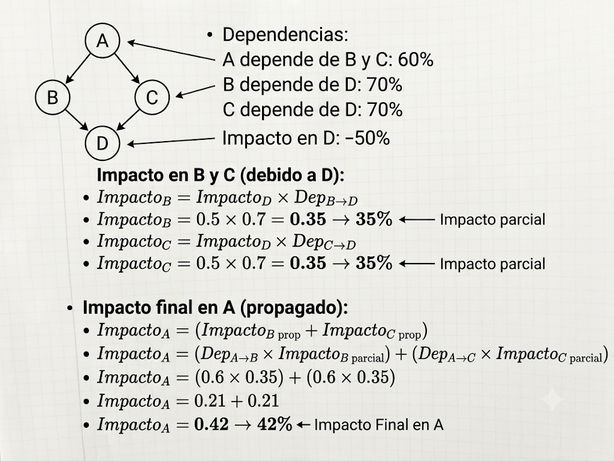
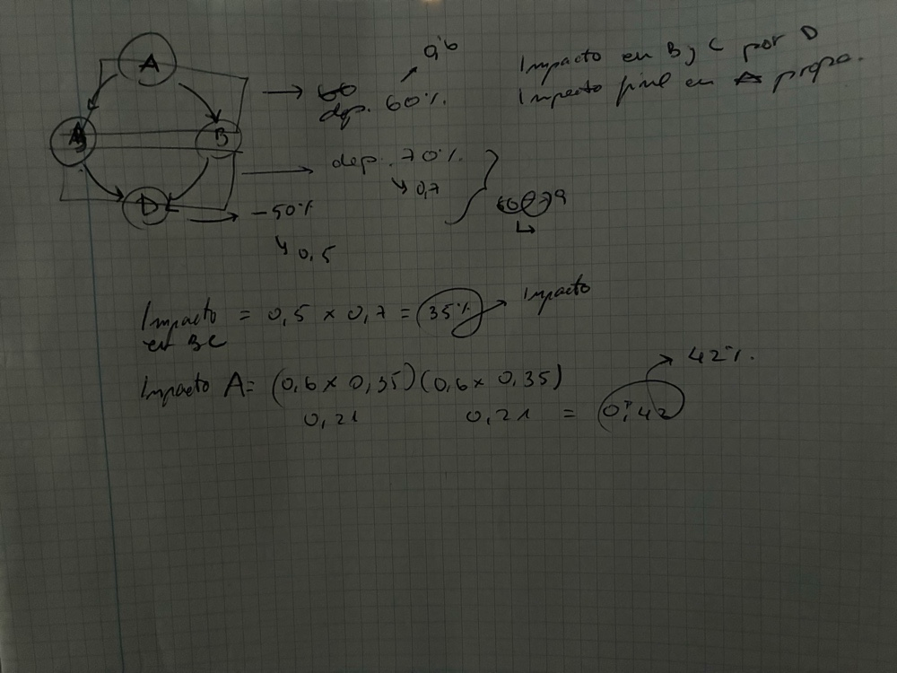
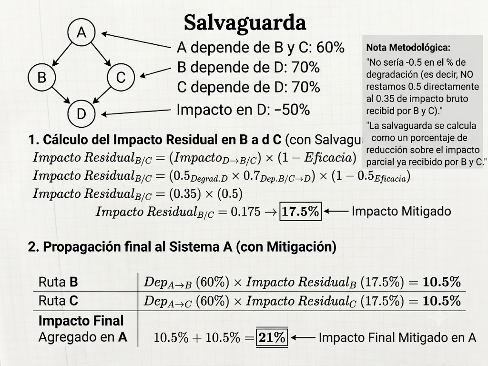
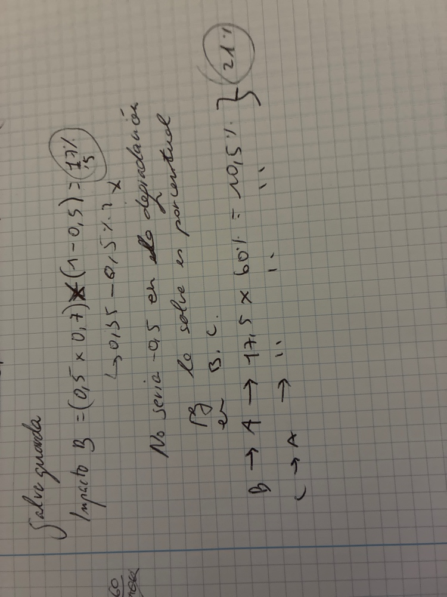

# AP 11 · Propagación de Impacto (BIA)

**Auditor:** Xavier Margalef · **Fecha:** 2 de julio de 2026
**Actividad:** Modelado de dependencias y mitigación en cascada, bajo [NIST SP 800-34](https://csrc.nist.gov/pubs/sp/800/34/r1/final) (Contingency Planning)

## Actividad 01 — Cuantificación de impacto (línea base)

Impacto operacional en cascada dentro del árbol de dependencias: cómo la degradación de un activo de soporte se propaga hasta el activo crítico de negocio.

### Inventario de activos y dependencias

| | |
|---|---|
| Activo principal | Sistema A (core de negocio) |
| Activos intermedios | Sistema B y Sistema C (soporte operativo) |
| Activo base | Servidor D (infraestructura crítica) |
| Topología | Dependencia tipo **Diamante** — convergencia paralela |
| Degradación de D | 50% (0,5) |
| Dependencia B/C → D | 70% (0,7) |
| Dependencia A → B y A → C | 60% (0,6) cada una |

### Fase 1 — Impacto en B y C por el fallo en D

La degradación de D se transfiere a los sistemas intermedios en proporción a su nivel de dependencia (modelo [BIA](https://www.ready.gov/business-impact-analysis)):

$$\text{Impacto} = \text{Degradación origen} \times \text{Factor de dependencia}$$

- B: 0,50 × 0,70 = **35%**
- C: 0,50 × 0,70 = **35%**

### Fase 2 — Impacto final en A

El enunciado no especifica si A dispone de tolerancia a fallos (alta disponibilidad, failover — ver [ISO/IEC 27031](https://www.iso.org/standard/46219.html)), así que el impacto de ambas ramas se acumula linealmente:

- Canal B: 35% × 0,60 (dependencia A→B) = **21%**
- Canal C: 35% × 0,60 (dependencia A→C) = **21%**
- **Impacto total en A: 21% + 21% = 42%**

## Actividad 02 — Incidentes y mitigación con salvaguardas

### Clasificación de la dependencia

Dependencia de **Diamante**: el riesgo nace en un único punto único de fallo (Servidor D), se bifurca en paralelo por dos nodos independientes (B y C) y converge de nuevo en el activo crítico superior (A).

### Caso de estudio: salvaguarda con eficacia del 50% en B y C

Según [MAGERIT v3](https://administracionelectronica.gob.es/pae_Home/pae_Documentacion/pae_Metodologias/pae_Magerit.html) y los principios de [BCP](https://www.iso.org/standard/75106.html), la salvaguarda en un nodo intermedio se calcula **sobre el impacto parcial ya recibido por ese nodo (35%)**, nunca restando directamente del daño original en la raíz: una salvaguarda en B o C no puede anular la avería física de D, que sigue existiendo. Restar directamente (0,5 − 0,5 = 0) implicaría justo eso, y es arquitectónicamente incorrecto.

**Impacto bruto en B/C** (sin cambios respecto a la Fase 1): 0,50 × 0,70 = **35%**

**Impacto residual tras la salvaguarda** (eficacia 50%):
$$\text{Impacto residual} = \text{Impacto bruto} \times (1 - \text{Eficacia}) = 0{,}35 \times 0{,}50 = \mathbf{17{,}5\%}$$

**Propagación hacia A con el impacto ya mitigado:**

- Canal B: 17,5% × 60% = **10,5%**
- Canal C: 17,5% × 60% = **10,5%**
- **Impacto final en A: 10,5% + 10,5% = 21%**

## Conclusión comparativa

| Escenario | Impacto residual en B/C | Impacto total en A | Estado del core |
|---|---|---|---|
| Línea base (sin controles) | 35% | **42%** | Servicio degradado (58% de capacidad) |
| Mitigado (salvaguarda 50%) | 17,5% | **21%** | Operación estable (79% de capacidad) |
