# Respuesta a Incidente: Contenedor Docker No Autorizado

**Auditor:** Xavier Margalef Riestra
**Fecha:** Julio 2026
**Metodología:** Ciclo de respuesta a incidentes (identificación → contención → erradicación) aplicado a un entorno Docker

---

## Resumen

Un servidor Ubuntu con Docker reporta un consumo de CPU anómalo. El responsable del servicio confirma que únicamente debería existir un contenedor autorizado, `web-corporativa` (servidor web en el puerto 8080). El análisis identifica un segundo contenedor, `worker-17`, consumiendo el 25,25% de CPU en un bucle infinito sin ninguna función de negocio asociada. Se sigue un proceso disciplinado de respuesta a incidentes — recopilación de evidencia antes de cualquier acción destructiva, contención, verificación del servicio legítimo y erradicación final — evitando eliminar el contenedor sospechoso antes de preservar la evidencia necesaria para el análisis.

---

## Fase 1 — Inventario del sistema

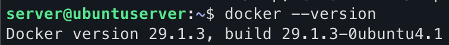
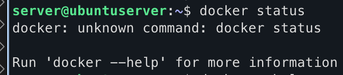
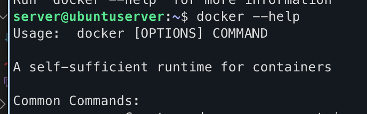
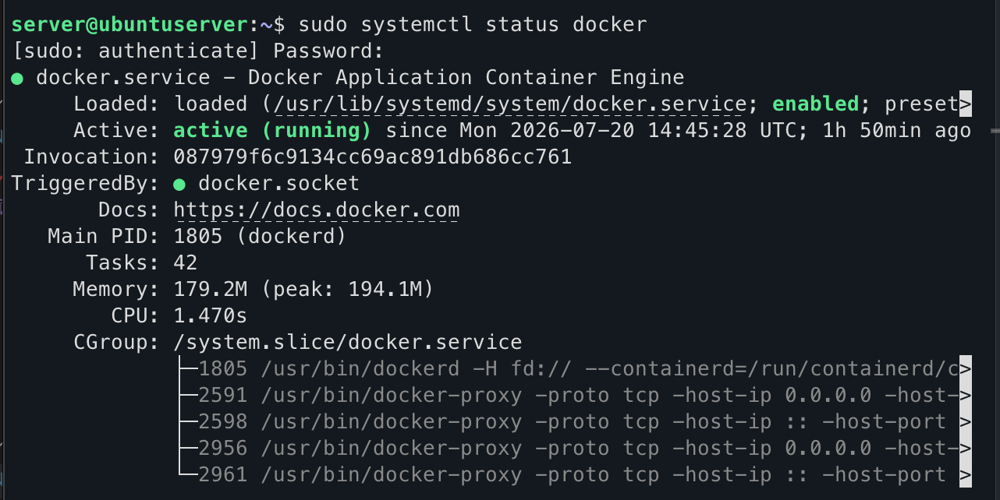
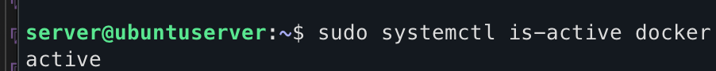
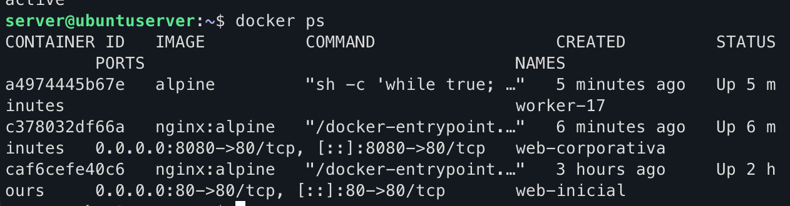
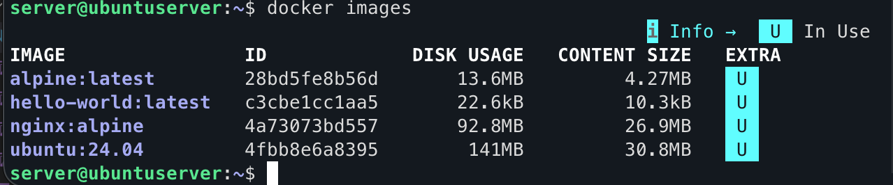

```
server@ubuntuserver:~$ docker ps -a
CONTAINER ID   IMAGE          COMMAND                  CREATED         STATUS                  PORTS                                     NAMES
a4974445b67e   alpine         "sh -c 'while true; …"   7 minutes ago   Up 7 minutes                                                      worker-17
c378032df66a   nginx:alpine   "/docker-entrypoint.…"   7 minutes ago   Up 7 minutes            0.0.0.0:8080->80/tcp, [::]:8080->80/tcp   web-corporativa
caf6cefe40c6   nginx:alpine   "/docker-entrypoint.…"   3 hours ago     Up 2 hours              0.0.0.0:80->80/tcp, [::]:80->80/tcp       web-inicial
af7cb001dd39   ubuntu:24.04   "bash"                   3 days ago      Exited (0) 3 days ago                                             labubuntu
0ad3a66e6a85   hello-world    "/hello"                 3 days ago      Exited (0) 3 days ago                                             flamboyant_cerf
```

| Contenedor | Imagen | Estado | Puerto |
|---|---|---|---|
| `web-corporativa` | `nginx:alpine` | Up | 8080→80 |
| `worker-17` | `alpine` | Up | — (sin puerto publicado) |

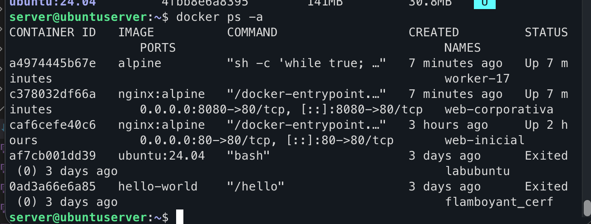

`docker ps` únicamente muestra los contenedores activos; `docker ps -a` muestra también los detenidos (`labubuntu`, `flamboyant_cerf`), que no son relevantes para este incidente al no estar en ejecución.

## Fase 2 — Identificación de activos autorizados

```bash
curl -i http://localhost:8080
```

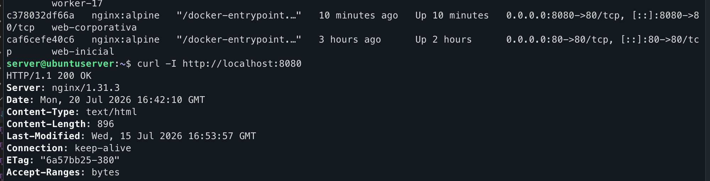

El servidor web responde correctamente con `HTTP/1.1 200 OK`, confirmando que `web-corporativa` es el servicio legítimo y operativo.

## Fase 3 — Detección y análisis de anomalías

```bash
docker stats --no-stream
```

```
CONTAINER ID   NAME        CPU %     MEM USAGE / LIMIT     MEM %     NET I/O           BLOCK I/O   PIDS
a4974445b67e   worker-17   25.25%    352KiB / 4.036GiB     0.01%     1.12kB / 126B     0B / 0B     1
```

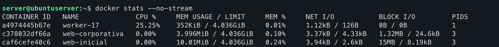

`worker-17` consume un 25,25% de CPU, muy por encima del consumo esperado para un contenedor que la empresa no reconoce como propio. Este consumo coincide con el contenedor no autorizado (la política de la organización establece que únicamente debe existir `web-corporativa`).

**¿Puede afirmarse únicamente por el consumo de CPU que un contenedor es malicioso?** No de forma aislada. `worker-17` es sospechoso porque combina dos indicadores: un consumo de CPU anómalo (25,25%) y el incumplimiento de la política de activos autorizados de la empresa. Son necesarias evidencias adicionales — procesos, comando de arranque, configuración — antes de clasificarlo definitivamente como malicioso.

## Fase 4 — Análisis de procesos

```bash
docker top worker-17
```

```
UID    PID    PPID   C    STIME   TTY   TIME       CMD
root   3053   3030   25   16:30   ?     00:04:51   sh -c while true; do :; done
```

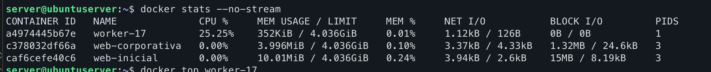

**Diferencias entre ambos contenedores:** `worker-17` muestra un consumo de CPU muy superior al de `web-corporativa`, pero memoria, red y E/S de disco mínimos — un único proceso activo consumiendo CPU sin realizar trabajo útil. `web-corporativa`, en cambio, no muestra actividad relevante de CPU más allá de atender peticiones HTTP puntuales.

**Comando ejecutado por el contenedor sospechoso:** `sh -c 'while true; do :; done'` — un bucle infinito sin ninguna función legítima aparente, consistente con un contenedor de prueba, un error de despliegue, o una carga para agotar recursos (resource exhaustion / minería no autorizada en un escenario real).

## Fase 5 — Inspección del contenedor sospechoso

```bash
docker inspect worker-17
```

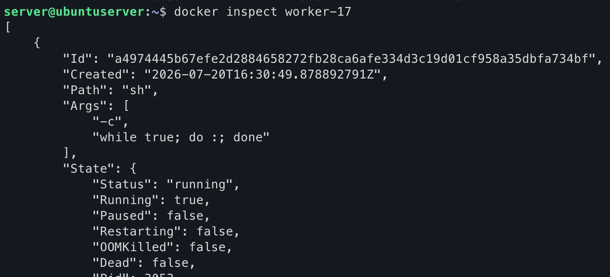
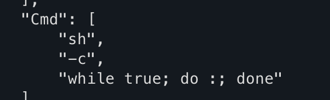

Campos relevantes extraídos de la salida completa de `inspect`:

| Campo | Valor |
|---|---|
| Imagen | `alpine` (`sha256:28bd5fe8b56d...`) |
| Comando (`Cmd`) | `sh -c "while true; do :; done"` |
| Creado | 2026-07-20T16:30:49Z |
| Estado | `running: true`, `paused: false`, `restarting: false` |
| `Privileged` | `false` |
| `NetworkMode` | `bridge` (IP interna `172.17.0.4`) |
| Puertos publicados | ninguno |
| Límite de CPU (`NanoCpus`) | 250.000.000 (0,25 CPU — coincide con el `--cpus="0.25"` del lanzamiento) |
| `CapAdd` / `CapDrop` | sin capacidades adicionales |

El contenedor no está en modo privilegiado, no publica puertos y no monta volúmenes del host — su superficie de riesgo inmediata es limitada al propio consumo de CPU, pero el incumplimiento de la política de activos autorizados por sí solo justifica la investigación y contención.

## Fase 6 — Análisis del contenedor legítimo

```bash
docker logs web-corporativa
```

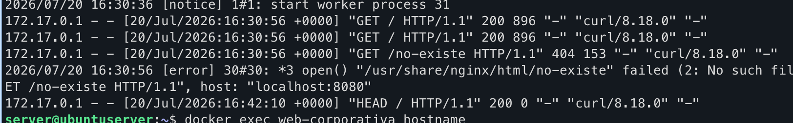

```
172.17.0.1 - - [20/Jul/2026:16:30:56 +0000] "GET / HTTP/1.1" 200 896 "-" "curl/8.18.0" "-"
172.17.0.1 - - [20/Jul/2026:16:30:56 +0000] "GET / HTTP/1.1" 200 896 "-" "curl/8.18.0" "-"
172.17.0.1 - - [20/Jul/2026:16:30:56 +0000] "GET /no-existe HTTP/1.1" 404 153 "-" "curl/8.18.0" "-"
2026/07/20 16:30:56 [error] 30#30: *3 open() "/usr/share/nginx/html/no-existe" failed (2: No such file or directory), client: 172.17.0.1, server: localhost, request: "GET /no-existe HTTP/1.1", host: "localhost:8080"
172.17.0.1 - - [20/Jul/2026:16:42:10 +0000] "HEAD / HTTP/1.1" 200 0 "-" "curl/8.18.0" "-"
```

La única petición con error es `GET /no-existe` (404): el servidor intenta acceder a `/usr/share/nginx/html/no-existe`, que no existe en el sistema de ficheros del contenedor. Es un error de recurso no encontrado, no un fallo del servidor ni indicio de compromiso.

**¿Por qué son importantes los logs durante un incidente de seguridad?** Son la base de la trazabilidad: permiten monitorizar la actividad real del servicio, sostener el análisis forense posterior al incidente y retroalimentar el ciclo de mejora continua (PDCA) sobre los planes de continuidad (BCP) y recuperación (DRP) de la organización.

## Fase 7 — Acceso al contenedor legítimo

```bash
docker exec web-corporativa hostname
docker exec web-corporativa whoami
docker exec -it web-corporativa sh
```

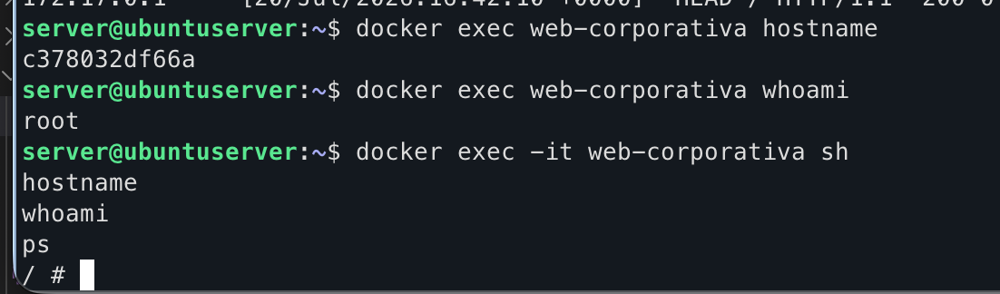
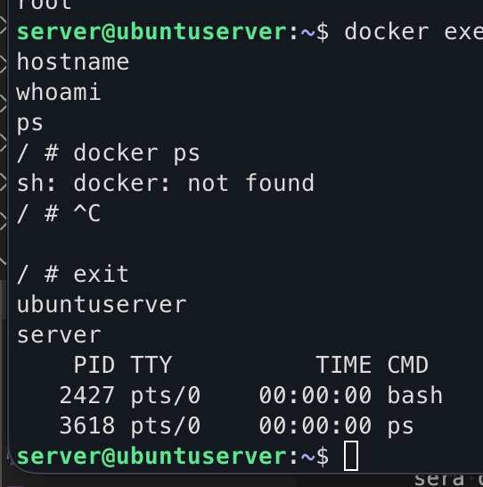

Dentro de la sesión interactiva, `hostname`, `whoami` y `ps` permiten confirmar el entorno interno del contenedor y sus procesos activos sin alterar su estado.

**¿Se detiene `web-corporativa` al ejecutar `exit`?** No. `exit` únicamente cierra la sesión interactiva abierta mediante `docker exec`; el proceso principal del contenedor (nginx) sigue en ejecución. Para detener el contenedor realmente sería necesario `docker stop web-corporativa`.

## Fase 8 — Contención del incidente

Confirmado que `worker-17` no es un servicio autorizado, el primer objetivo de la respuesta es detener la actividad sospechosa sin perder evidencia, y después verificar que el servicio legítimo no se ha visto afectado.

```bash
docker stop worker-17
```

Antes de detenerlo, `docker ps` confirma que seguía activo:
```
a4974445b67e   alpine   "sh -c 'while true; …"   39 minutes ago   Up 39 minutes   worker-17
```
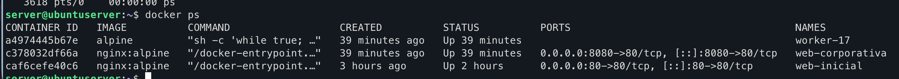

Tras `docker stop worker-17`, `docker ps` ya no lo lista como activo, 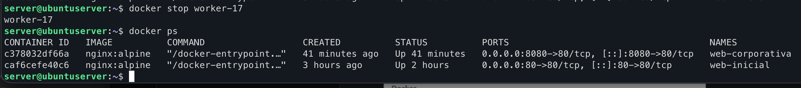 y `docker ps -a` lo muestra como `Exited`: el contenedor sigue existiendo, pero detenido. 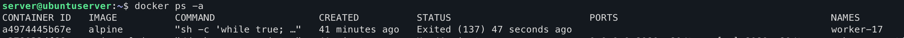

**¿Por qué detener un contenedor antes de eliminarlo?** Permite preservar evidencia para la investigación: revisar su configuración completa con `docker inspect`, analizar sus logs con `docker logs worker-17`, y examinar imagen, comando y procesos antes de que esa información se pierda de forma irrecuperable. Eliminar directamente destruiría datos potencialmente necesarios para determinar el origen del incidente.

## Fase 9 — Comprobación del servicio legítimo

```
c378032df66a   nginx:alpine   ...   Up 41 minutes   0.0.0.0:8080->80/tcp   web-corporativa
caf6cefe40c6   nginx:alpine   ...   Up                                     web-inicial
a4974445b67e   alpine         ...   Exited (137)                           worker-17
```

`web-corporativa` permanece en estado `Up`, el servicio nginx sigue ejecutándose y el puerto 8080 continúa publicado y accesible — la contención del incidente no ha afectado al servicio autorizado. `worker-17` aparece como `Exited (137)`: ya no está en ejecución.

## Fase 10 — Erradicación

Recopilada la evidencia y contenido el incidente, se procede a eliminar el contenedor no autorizado:

```bash
docker rm worker-17
```

Antes de la eliminación, `docker ps -a` confirma que `worker-17` todavía existe en estado `Exited (137)` — evidencia de que el contenedor fue detenido (no destruido) durante la fase de contención, preservando la posibilidad de análisis forense hasta este último paso.

---

## Conclusión

El incidente se resuelve siguiendo el orden correcto de respuesta: identificación mediante inventario y métricas de consumo, análisis de procesos y configuración antes de actuar, contención (detener sin eliminar) para preservar evidencia, verificación de que el servicio legítimo no resultó afectado, y erradicación únicamente al final del proceso. El contenedor `worker-17` no publicaba puertos ni corría en modo privilegiado, por lo que su impacto se limitó al consumo de recursos — pero el incumplimiento de la política de activos autorizados de la empresa es, por sí solo, motivo suficiente para tratarlo como incidente de seguridad y no como una simple anomalía de rendimiento.
